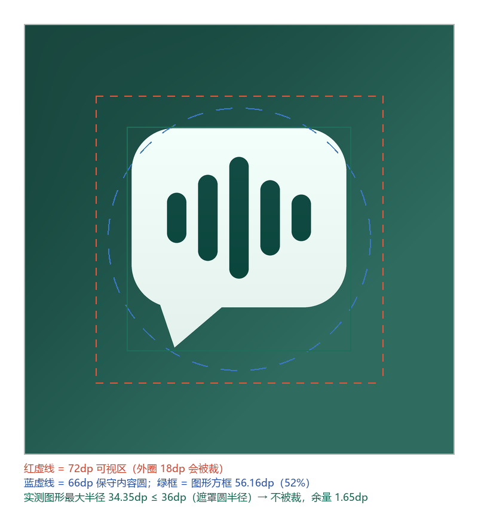
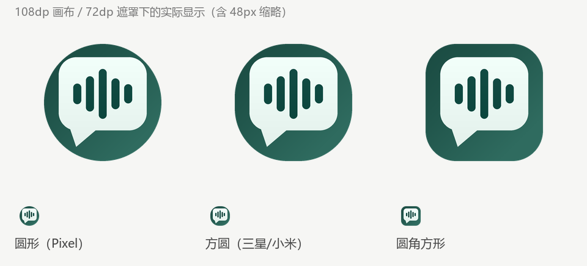

# 应用图标规范（v3.9 · 随 0.4.32 上线）

> 配套图：`brand/icon-masks.png`（三种启动器遮罩下的实际显示）、
> `brand/icon-safe-zone.png`（自适应安全区标注）、`brand/icon-preview.png`（各尺寸对比）、
> 母版 `brand/icon-1024.png` / `brand/icon-1024-round.png` / `brand/icon-512.png`。
> 生成脚本：`tools/make_icon.py`。

## 0. 先说结论

**三套皮肤共用一枚图标。** 图标不属于任何一套皮肤、不随皮肤切换 ——
它承担的是「打开手机就能找到这个 App」的品牌识别，不是界面的一部分。
所以这里不新增 `SkinTokens` 字段，也不做 A/E/H 三版图标。

图标本身：**深青渐变底 + 一枚近白对话气泡 + 五根声纹条**。

## 1. 为什么现在才有

0.4.31 及之前，`mipmap-*/ic_launcher.png` 一直是 **Flutter 默认图标**（浅蓝 Z 字）。
装到手机上跟任何另一个 Flutter App 放一起就分不出来。这一版补上。

## 2. 图形构成

三层，从下到上：

| 层 | 内容 | 取值 |
|---|---|---|
| 底 | 对角线渐变（135°）+ 左上薄荷径向高光 | `#0A332C` → `#2F6B5F`，高光 `#A0F2DF` @ 16% |
| 主体 | 圆角对话气泡 + 左下尾巴 | 近白 `#F2FFFA` |
| 内容 | 五根圆头声纹条 | 深青 `#064239` |

- **气泡**：这个 App 的核心对象就是对话，比「信封 / 盒子 / 麦克风」都直白。
- **声纹**：「留声」的字面意思，也让图标不像一个普通的聊天气泡。
- **腰线/描边/阴影：全部没有。** 与界面「零阴影」规则一致 —— 图标靠底色对比，不靠细节。
  底色的两个端点都是**图标专用**色，不参与三套皮肤的 token（可见 `tokens/token-table.md` 末尾）。

## 3. 几何

坐标都归一化到「图形方框」的边长 `u`（母版里 `u = 0.52 × 108dp = 56.16dp`，传统图标里 `u = 0.66 × 画布`）：

| 项 | 值 | 说明 |
|---|---|---|
| 气泡宽 / 高 | `0.96u` / `0.80u` | 高宽比 ≈ 1.2，比正方更"说话" |
| 气泡左边距 | `0.02u` | 左右对称留白 |
| 气泡圆角 | `0.24 × 气泡高` | 再圆就成圆片，再方像卡片 |
| 尾巴根部 | `0.12u` ~ `0.42u`（底边上方 `0.94 × 气泡高`） | 根部压进气泡体内，并集无缝 |
| 尾巴尖 | `0.20u`，低于底边 `0.225 × 气泡高` | 略偏左下，尾巴朝下 |
| 声纹条宽 / 间距 | `0.090u` / `0.055u` | 五根等距、圆头 |
| 声纹高度 | `0.28 / 0.48 / 0.68 / 0.42 / 0.26`（× 气泡高） | 不对称包络 = 人声，不是均衡器 |

**48px 是下限验收点**：此时气泡约 30px 宽、单根条 ≈ 2.7px、间距 ≈ 1.7px，
靠「浅色块 + 深色竖条」两层明度差仍然认得出；再小（32px）只保留轮廓不保证条数。

## 4. 自适应图标（Android 8+）



- 画布 **108dp**，外圈 **18dp** 可能被裁，中间 **72dp** 是保证可见区；
- 图形方框 = **108 × 0.52 = 56.16dp**，放在正中；
- **0.52 不是随便取的**：气泡带尾巴后接近正方（≈ 54 × 56dp），
  外接矩形四角到中心的距离必须 ≤ 遮罩圆半径 36dp。取 0.62 会被 Pixel 的圆形遮罩切掉两端。
- 实测（脚本 `--diagram` 每次自测）：图形最远不透明点 **34.35dp** ＜ 36dp → 不切，
  余量 1.65dp。
- 它**略超出** 66dp 保守内容圆（半径 33dp）1.35dp。标准圆形遮罩不会切，
  但若以后接到遮罩更激进的 ROM，把 `ADAPTIVE_MARK_RATIO` 从 `0.52` 调到 **`0.50`**
  （最远点 ≈ 33.03dp，正好压进保守圆），重出图即可 —— 不需要改几何。

### 遮罩预演



## 5. 交付物

| 用途 | 位置 |
|---|---|
| 传统图标 48/72/96/144/192 | 工程库 `android/app/src/main/res/mipmap-*/ic_launcher.png` |
| 传统圆形图标（`android:roundIcon`） | 同上 `ic_launcher_round.png` |
| 自适应前景（108/162/216/324/432） | 同上 `ic_launcher_foreground.png` |
| Android 13+ 主题图标（单色模板） | 同上 `ic_launcher_monochrome.png` |
| 自适应声明 / 背景渐变 | 同上 `mipmap-anydpi-v26/ic_launcher*.xml`、`drawable/ic_launcher_background.xml` |
| 母版 / 商店图 | 本库 `brand/`（1024 方形、1024 圆形、512） |

**单色层不是另一套图形**：它就是「气泡不透明 + 声纹挖洞」的 alpha 模板，
系统按壁纸染色。所以设计稿上不要单独画一版黑色图标。

## 6. 备选与淘汰方案

| 方案 | 为什么不用 |
|---|---|
| 唱片（留声机）+ 中心标签 | 48px 上同心纹路变噪点；且读起来像音乐播放器 |
| 双气泡叠加 | 96px 以下两个气泡边缘糊在一起 |
| 下颚与左边缘共线的 Material 气泡 | 气泡一宽就变成「折角文件」，像文档图标 |
| 薄荷气泡 + 深青条（`--variant mint`） | 备选保留，代码里有；对比度比近白版低一档，48px 不如现在这版 |

## 7. 怎么改

```bash
# 母版与所有密度（写到工程库 res/ 与 docs/brand/）
python tools/make_icon.py --root <keepsake 源码库>
# 只出预览 / 规范图
python tools/make_icon.py --preview preview.png
python tools/make_icon.py --diagram brand/
# 换配色
python tools/make_icon.py --root <keepsake 源码库> --variant mint
```

几何与颜色都在脚本顶部：`GEO`（气泡 / 尾巴 / 声纹）、`BG_TOP`/`BG_BOTTOM`/`BUBBLE_*`/`BARS_*`。

**四个已经踩过的坑**，改之前先看一眼：

1. **尾巴根部必须压在气泡体内**（`tail_top < 1.0`）。取 1.0 时圆角会把根部留在外面，
   48px 上表现为「气泡底下多一块独立方块」。
2. **尾巴尖不能超出图形方框**（`bubble_y + bubble_h × (1 + tail_depth) ≤ 1.0`）。
   早先版本尾巴尖伸到 1.09，被方框裁平成一条横边。
3. **自适应前景必须是透明底**。传统图标自带圆角方底，塞进 `<foreground>` 会看到方图套圆底。
4. **单色层用位图 alpha 模板，不要另写矢量**。同一套坐标抄两遍必对不上（真的对不上过）。

## 8. 验收

- [ ] 48px 下能认出是「气泡 + 竖条」，条与条之间没糊成一块。
- [ ] 圆形遮罩（72dp）下气泡两端和尾巴都不被切（脚本 `--diagram` 会打印实测半径）。
- [ ] 主题图标（Android 13+）在深色壁纸上能看清，声纹是挖空的。
- [ ] 传统图标 + 自适应图标在同一个启动器里不会一个圆一个方。
